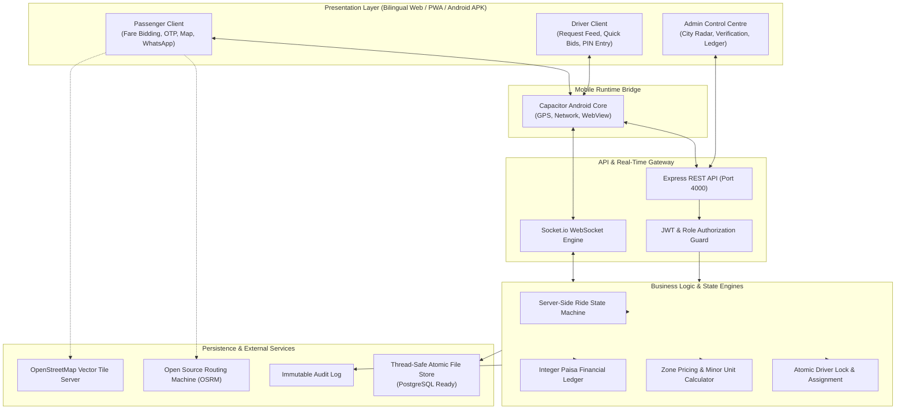
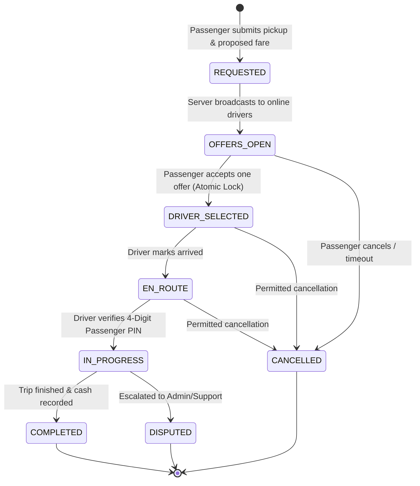
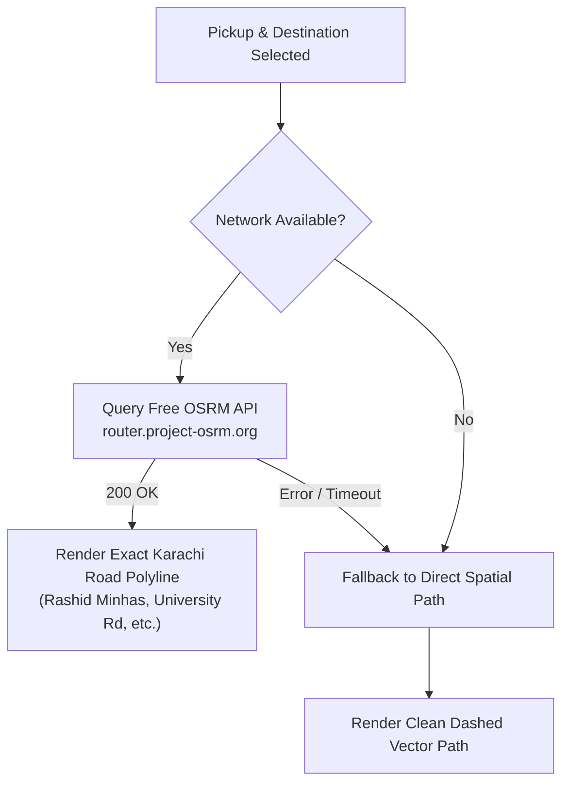
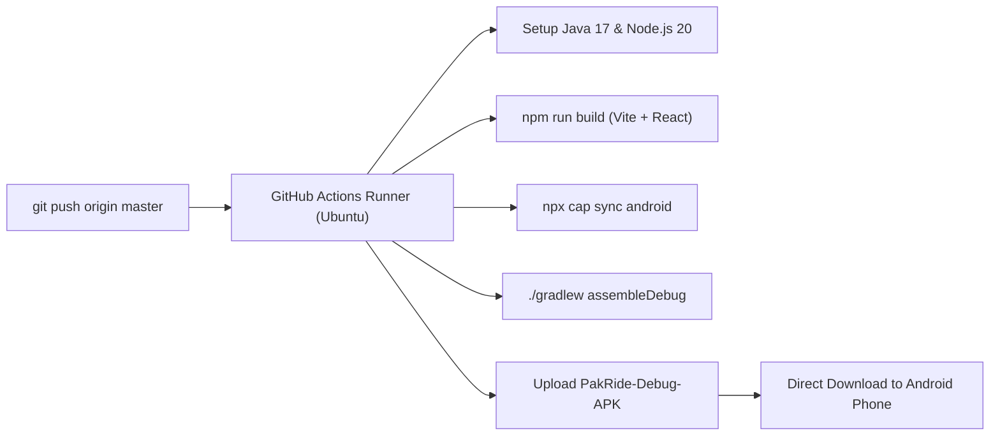

# 🏛️ PakRide — System Architecture & Engineering Blueprint

---

## 1. High-Level Architecture

The PakRide platform employs a modular client-server architecture with real-time bidirectional push via WebSockets, strict server-side state enforcement, and a cross-platform mobile presentation layer.

---

## 2. Server-Enforced Ride State Machine

The ride lifecycle transitions strictly through server-validated state gates. Direct or out-of-order client transitions are rejected with an error.

### State Transition Invariants
1. **Atomic Assignment:** When a passenger selects Offer $A$, all competing offers for the same `rideId` are immediately transitioned to `REJECTED` in an atomic lock, preventing concurrent double-booking.
2. **PIN Verification Gate:** Transitioning from `EN_ROUTE` to `IN_PROGRESS` strictly requires the driver to pass the passenger's matching `verificationOtp`.
3. **Cash Reconcile Trigger:** Transitioning to `COMPLETED` automatically records an entry in the financial ledger and updates driver net earnings.

---

## 3. Real-Time WebSocket Protocol

Communication between clients and the server runs over persistent Socket.io connections with room partitioning.

| Event Name | Direction | Payload | Purpose |
| :--- | :---: | :--- | :--- |
| `join_user_room` | Client $\rightarrow$ Server | `userId` | Subscribes client to private notifications. |
| `new_ride_available` | Server $\rightarrow$ Drivers | `RideRequest` | Broadcasts new ride in the active zone. |
| `submit_driver_offer` | Driver $\rightarrow$ Server | `rideId, counterFarePkr, eta` | Sends driver counteroffer. |
| `new_offer_received` | Server $\rightarrow$ Passenger | `offer` | Pushes counteroffer directly to passenger room. |
| `accept_driver_offer` | Passenger $\rightarrow$ Server | `offerId` | Triggers atomic assignment. |
| `offer_accepted_notify` | Server $\rightarrow$ Winning Driver | `ride, offer` | Alerts chosen driver with pickup coordinates. |
| `ride_status_changed` | Server $\rightarrow$ Both | `ride` | Updates trip progression (`EN_ROUTE`, `IN_PROGRESS`, etc.). |
| `driver_location_update` | Driver $\rightarrow$ Server | `lat, lng` | Broadcasts live GPS to passenger and Admin Radar. |

---

## 4. Geographic & Road Routing Architecture

To eliminate reliance on expensive commercial mapping APIs during early testing, the platform uses a **two-tier routing architecture**:

* **Street-by-Street Polylines:** Real-time road route coordinates are dynamically requested from OSRM (`/route/v1/driving/...`) and drawn directly onto Leaflet.
* **Fallback Resilience:** If connectivity is lost or OSRM is slow, the client falls back to direct coordinate vector calculation without crashing or interrupting ride booking.
* **Local Anchors:** Gulistan-e-Jauhar pilot landmarks (Jauhar Chowrangi, Millennium Mall, Airport, etc.) are pre-indexed with exact coordinates.

---

## 5. Financial Ledger & Minor Unit Integrity

To ensure zero rounding errors across all driver earnings, platform fees, and future digital payouts:

$$\text{Paisa} = \text{PKR} \times 100$$

* All values are strictly integers (`number` with no decimals).
* All ledger entries record:
  * `ride_id`
  * `gross_amount_paisa`
  * `platform_commission_paisa` (0% introductory)
  * `driver_net_paisa`
  * `reconciled_at` timestamp

---

## 6. Mobile APK CI/CD Architecture

* **Capacitor Android Core:** Wraps the PWA inside a high-performance native WebView with hardware-accelerated rendering and GPS access.
* **Automated Cloud Build:** Compiles the `.apk` on GitHub's cloud runners without needing local Android Studio or SDK installations.
